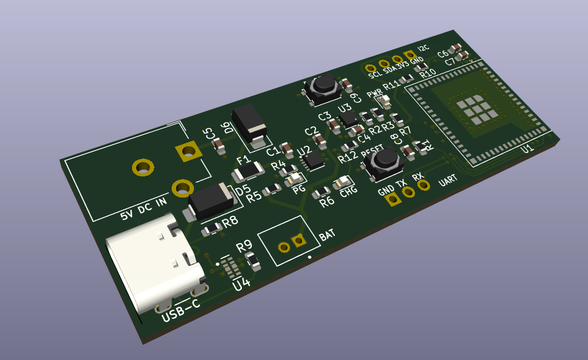
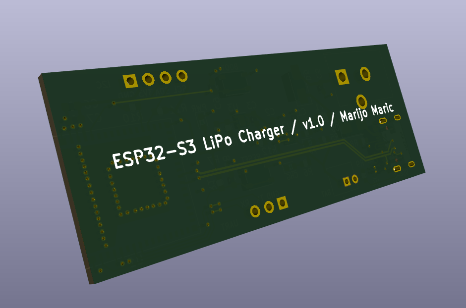
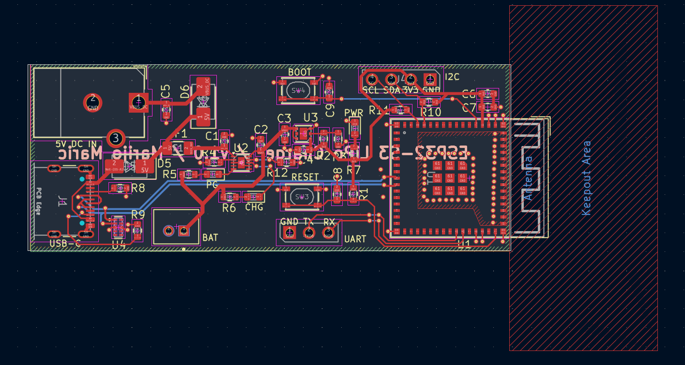
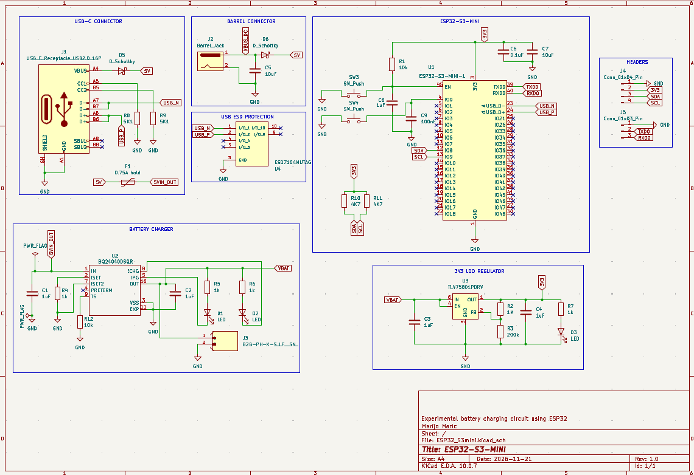

# ESP32-S3-MINI Development Board

  
  

## Overview

Custom ESP32-S3-MINI development board designed in KiCad for wireless embedded systems and battery-powered applications.

## Hardware Features

* ESP32-S3-MINI module
* USB Type-C power and data interface
* 5 V DC barrel jack input
* BQ24040 single-cell Li-ion/LiPo battery charger
* TLV75801 adjustable voltage regulator configured for 3.3V
* ESD7104 USB ESD protection
* Schottky diode power input isolation
* 0.75 A hold-current resettable fuse
* JST battery connector
* UART and I2C communication interfaces
* BOOT and RESET push buttons
* Charging, power-good and power indicator LEDs

## PCB Specifications

| Parameter | Specification |
|---|---|
| PCB layers | 4 |
| PCB thickness | Approx. 1.6 mm |
| Input voltage | 5 V / single-cell Li-ion or LiPo battery |
| Operating voltage | 3.3 V |
| Design software | KiCad |

## PCB Layout

  

## Schematic

  

